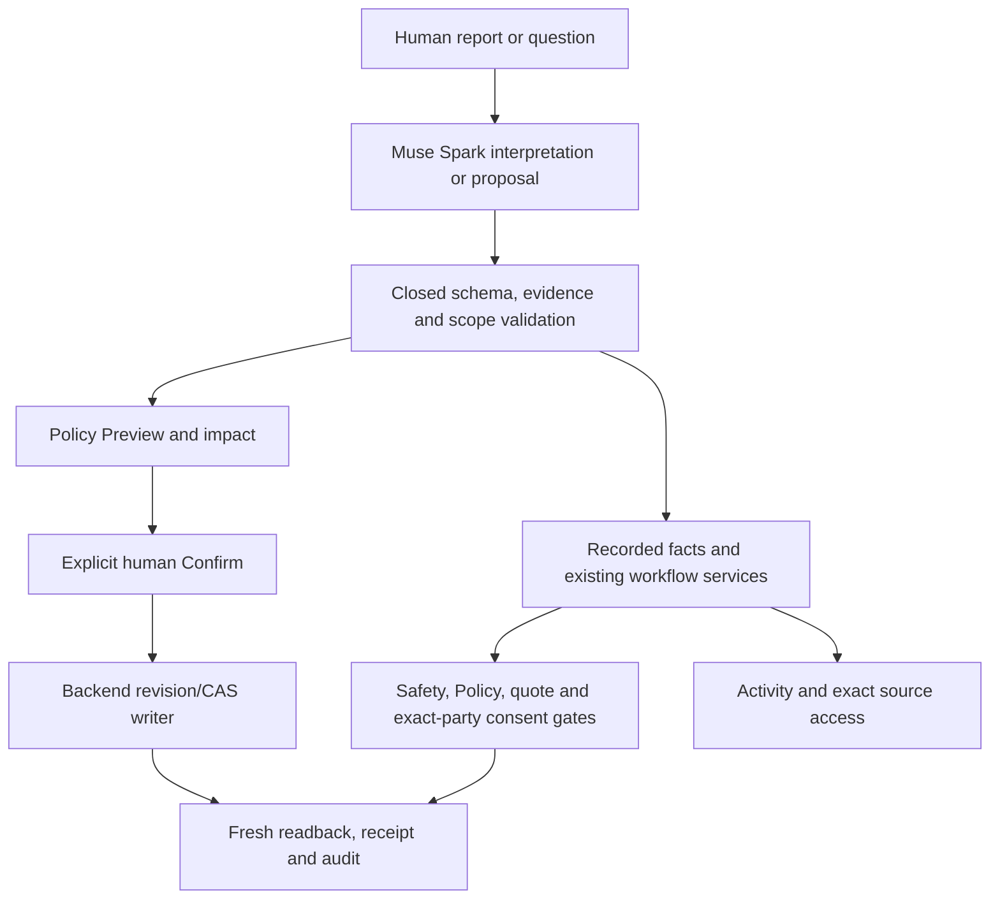

# Artrelo

### AI-assisted property maintenance, with deterministic controls and human authority.

Artrelo helps landlords and property managers turn unstructured tenant reports into coordinated maintenance work. Iris interprets reports, reviews itemized costs and helps explain or propose changes to operational Policy. The surrounding software owns identity, scope, safety, revision checks, spending approvals and visit consent.

**Meta Global AI Developer Hackathon — October26–November4,2026.** This is an accepted source checkpoint, not a production-readiness certificate. The project extends a pre-existing product; the contribution breakdown below explains the difference.

## Demo video

[Watch the Artrelo demo on YouTube](https://youtu.be/EVId4MG_Aeg)

Video URL: https://youtu.be/EVId4MG_Aeg

**Hosted demo: pending.** Local synthetic exploration is documented in [the local setup guide](docs/PUBLIC_LOCAL_SETUP.md).

## Built during the hackathon

| Capability | Hackathon contribution | Engineering significance |
| --- | --- | --- |
| Muse Spark triage | [Bounded provider adapter and validation](backend/services/ai/triageProvider.service.js), used by [categorization](backend/services/ai/categorization.service.js) | Structured output is checked before downstream use; provider/fallback provenance remains explicit. Existing GPT intake and deterministic safety checks were reused. |
| New Activity views | [Shared Iris activity projection/views](frontend/src/app/components/iris-activity/IrisActivityViews.tsx) | Recorded transitions and evidence remain inspectable rather than inferred from a chat response. Generic activity/audit existed before the event. |
| Itemized cost review | [Quote/final-statement panel](frontend/src/app/components/request-detail/QuoteReviewPanel.tsx), [advisory contract](backend/services/quotes/analysisContract.service.js), [bounded clarification](backend/services/quotes/clarification.service.js) | Analysis is bound to recorded itemization/revision/evidence; advisory findings do not approve scope, payable amounts or payments. |
| Conversational Iris | [Semantic planner](backend/services/iris/planner.service.js), [explanation validator](backend/services/iris/explanation.service.js), [Policy change boundary](backend/services/iris/policyChange.service.js) | Read/source tools and constrained proposals are separated from Preview, explicit human Confirm, revision/CAS checks, readback and audit. |
| Reasoned visit changes | [Reschedule form](frontend/src/app/components/reschedule/RescheduleRequestForm.tsx) and [domain contract](backend/services/vendor/bookingReschedule.contract.js) | Reasoned alternatives preserve original/replacement facts, separate party responses and actual consent deadlines. Existing scheduling was reused. |
| Bounded judge simulation and provenance | [Judge domain adapter](backend/services/judgeSandbox/domain.service.js), [Guide presentation](frontend/src/app/components/judge/JudgeViews.tsx), [section badges](frontend/src/app/components/judge/JudgeBadges.tsx) | Simulated vendor steps use recorded server checkpoints and existing domain authority; labels distinguish synthetic actions and proven new sections from old product surfaces. |

See [the curated dated work map](NEW_WORK_PUBLIC.md) for commits and source anchors. The pre-hackathon baseline is **`adec601ba6854e47639c9dd8bf71d59b329e0edd`**, dated October24. Tenant intake, authentication/roles, property/request management, vendor registry/matching/outreach, next-vendor recovery, booking foundations, quote ranges/counteroffers and completion/dispute already existed. The Guide reuses those services; it is not a claim to have invented the entire lifecycle or recovery algorithm during the event.

The underlying problem is the coordination overhead between a report, a vendor response, a quote, a changed visit and human decisions. Artrelo combines model interpretation with explicit workflow boundaries so useful assistance can coexist with accountable human control. No impact or time-saved metric is claimed without measurement.

## How Muse Spark contributes

The guarded live lane selects **`muse-spark-1.3`**. The table describes code boundaries, not a claim that a model ran successfully for every request. Offline/fallback/unavailable responses remain distinct.

| Purpose | Bounded input → model output | Deterministic boundary → downstream action |
| --- | --- | --- |
| Intake triage | Supplied tenant conversation and approved schema → structured issue facts/triage fields | [Provider schema validation](backend/services/ai/triageProvider.service.js), [readiness](backend/services/ai/routingReadiness.service.js) and existing [safety gate](backend/services/ai/safetyGate.service.js) constrain use; a model classification does not create consent or bypass an emergency/human hold. |
| Quote and final-statement advisory | Owned request context, immutable itemized snapshot/revision, bounded history and source refs → advisory line flags/recommendations | [Analysis contract](backend/services/quotes/analysisContract.service.js) validates allowed line/source refs and closed advisory fields; quote vs invoice stage stays explicit. [Review/clarification](backend/services/quotes/clarification.service.js) still depends on recorded permission, freshness and human Decisions. |
| Iris semantic planning | Signed-in landlord's current request/context, supplied facts and allowlisted tools → bounded online plan/action proposal | [Planner](backend/services/iris/planner.service.js) and contracts reject invalid/foreign proposals; tool execution remains authenticated and scoped. A proposed Policy change prepares a preview, not a silent write. |
| Iris written explanation | Selected grounded facts/evidence and actual preview, if any → concise explanation blocks | [Explanation validation](backend/services/iris/explanation.service.js) rejects invalid evidence references, unsupported numbers/status and unbacked execution claims. The answer cannot claim an unperformed approval/payment/save. |

Illustrative boundary: an itemized statement can produce an advisory `possible_duplicate` or `scope_mismatch` flag, but it cannot return executable approval or money fields. A conversational Policy request can produce a draft; only the signed-in human's explicit Confirm may reach the backend writer. These examples describe allowed schemas, not manufactured model receipts.

## Where AI ends and deterministic software begins



The model does not own authentication, authorisation, payment, visit consent or a state-machine bypass. It does not replace the original vendor/recovery services. Source/evidence references connect explanations back to records; they are not certificates that the physical work or a transfer happened.

## Reliability and hard boundaries

| Failure or consequential operation | Code-level handling |
| --- | --- |
| Invalid structured model output | Closed schema/type/extra-field checks prevent treating an unusable body as valid triage or a tool command. Fallback/unavailable provenance is honest. |
| Safety-sensitive report | Existing deterministic [safety gate](backend/services/ai/safetyGate.service.js) remains outside model permission to progress ordinary work. |
| Vendor decline | The bounded [judge adapter](backend/services/judgeSandbox/domain.service.js) uses the existing routing/recovery/domain services and current checkpoints; no frontend guess, forced assignment or invented next state. |
| Stale or unknown action outcome | [Judge controller](frontend/src/app/components/judge/judgeController.ts) refreshes authoritative state instead of blindly resending an action; identity switches invalidate old scope. |
| Policy mutation | [Policy change service](backend/services/iris/policyChange.service.js) separates preview/confirmation, expected revision/hash, backend write, verification and audit. A no-op, mismatch or stale result is not success. |
| Cost review / repair completion | [Typed cost review](frontend/src/app/components/landlord/CostReviewDecision.tsx) keeps scope review, payable authorisation and tenant work confirmation distinct. Advisory analysis never approves spend. |
| Reschedule | Separate exact-party responses, a15-minute response floor and cutoff two hours before the earlier visit remain backend-controlled. Refusal/expiry does not imply the replacement was agreed. |

### Verification, with scope made explicit

| Accepted upstream checkpoint | Verified result / limit |
| --- | --- |
| Source `97e90073bddf0c755d93239c76806bd353983ecb` | Backend tree `4bcf3ce5205ff9c8a56307f88b97792d4500d1b4`, frontend tree `4903140a396d67b60ab52a7419f3bf26ad90acb7`. [Source manifest](SOURCE_MANIFEST.json) maps included committed bytes. |
| Maintained upstream backend | **221/221 maintained files passed** (448.764s; 16 measured source fingerprints unchanged), with three explicitly retained pre-existing quarantined files. These are backend test files, not browser scenarios. |
| Upstream frontend | **1,364 tests across129files passed** and isolated production build **47.307s**, with no source drift. These results belong to the accepted upstream application, not an install/build of this filtered public checkout. |
| Isolated fake-provider/native proofs | 22 native groups across38 inert databases; 38 real app HTTP requests/7 fake completions including quote and invoice advisory fixtures and actual landlord Iris narration; separate31HTTP/4fake alias/auth/preview proof. A further87HTTP connected synthetic Guide lifecycle covered decline, human cost review, rescheduling, tenant verification, synthetic Wallet, history/help and Policy preview/explicit Confirm/CAS receipt. These are offline/fake-provider results, not live model, browser or physical-work acceptance. |
| Public packaging | Static relative-import/require audit, redacted bounded scan and exact source-byte checks are separate from runtime, fresh-checkout and native/browser acceptance. See [verification scope](docs/VERIFICATION.md). |

This revision includes the Nov4 guarded landlord Iris mount, bounded advisory reason/reference validation and one-shot recording-retake recovery source. Pair7 was an earlier recording attempt that failed full-online qualification; the exact historical invalid-analysis cause was not retained. The pair8 take linked above **PASSED receipt-level online verification**: Meta intake was ready; two quote and two invoice advisories were READY; three completed Iris turns had six settled model attempts; and the human-confirmed default quota change from C$250 to C$300 was saved at revision2 with an audit receipt. The take used **14 physical Muse Spark sends for USD0.082561**, all settled, with zero new unknown outcomes or unresolved pair8 attempts. The help-article query returned zero facts, so successful article retrieval is not claimed. Explanation text is not durably retained, so the receipts alone cannot certify displayed model-written paragraphs. Vendors were simulated and Wallet values synthetic. No TLS, blanket production-readiness, flawless-AI or end-to-end native acceptance claim is made.

## Local setup and architecture

The source uses Node22, Express/Mongoose/MongoDB, React/Vite/Tailwind/Radix and self-hosted IBM Plex. `backend/`, `frontend/`, `shared/`, `marketing/` and `deploy/` preserve the relevant accepted application/build source. The ordinary marketing/static Dockerfile is **not** a hosted judge adapter.

Start with [fresh local offline setup](docs/PUBLIC_LOCAL_SETUP.md). It requires a private local transactional replica set, newly authored synthetic manifest/roster, your own hidden prompt inputs and installed locked dependencies on your isolated machine. No installation/server/model action was performed during packaging. The `.env.example` file is a **names-only inventory**, not a set of usable secrets or permission to bypass hidden-input startup. Do not copy an owner's environment or reuse rehearsal state.

Maintained test entry points, once you have reviewed scripts and isolated prerequisites:

```text
backend:  node tests/run_unit.js
frontend: vitest run with an isolated config and empty envDir
frontend: Vite production build with actual app plugins and empty envDir
```

The backend's generic `npm test` is a signup integration helper, not the maintained suite. No tests are removed to make the export appear green. The exported checkout's dependency installation, full tests/build and local runtime have **not** been exercised by the packaging worker; static import checks do not replace those steps.

## Current limitations

- **Hosted demo pending.** The owner-provided recording is linked above. Local instructions remain synthetic/offline and do not establish authenticated hosted access.
- Vendors are simulated. Wallet values, including illustrative CAD240 `pending_manual` with null bank reference, are synthetic: no bank transfer, paid status or physical-repair proof is implied.
- Human financial/scope decisions, Policy confirmation and vendor/tenant visit consent remain separate. A later default quota does not rewrite a previously submitted quote ceiling.
- Historical browser/focus/large-text findings remain qualified; source/unit checks do not prove native zoom, touch, screen-reader or every current rendered flow.
- The published source includes the reviewed Nov4 recovery changes. The linked pair8 recording has the receipt-backed online results stated above; those results do not certify every rendered explanation, a hosted deployment or production readiness. Private operational traces and credentials are excluded.
- An owner's local recording protocol expires Nov5 01:00Z and is not distributed as live authorisation. No key, owner account email/password, session, private trace or release credential is included here.

## Licence

Owner-selected **MIT**, copyright2026DeveloperXG, for team-owned published work. See [LICENSE](LICENSE), [third-party notices](THIRD_PARTY_NOTICES.md) and [dependency metadata](DEPENDENCY_LICENSES.json). IBM Plex retains its bundled OFL1.1 licence/provenance; dependencies retain their own terms. Legacy ISC package metadata was preserved rather than altering accepted application bytes. No reference screenshots, real tenant data or new downloaded assets are distributed.
